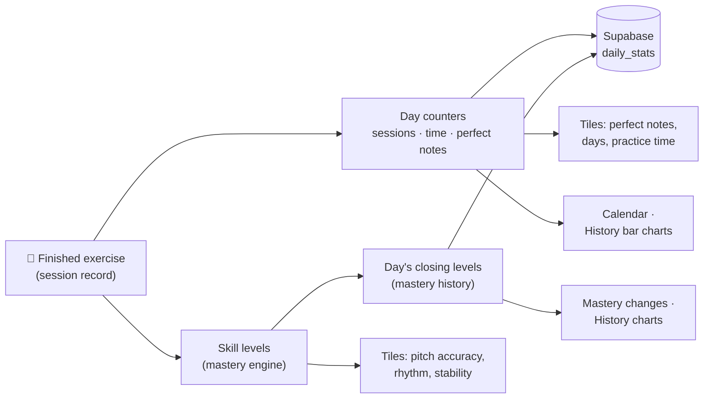
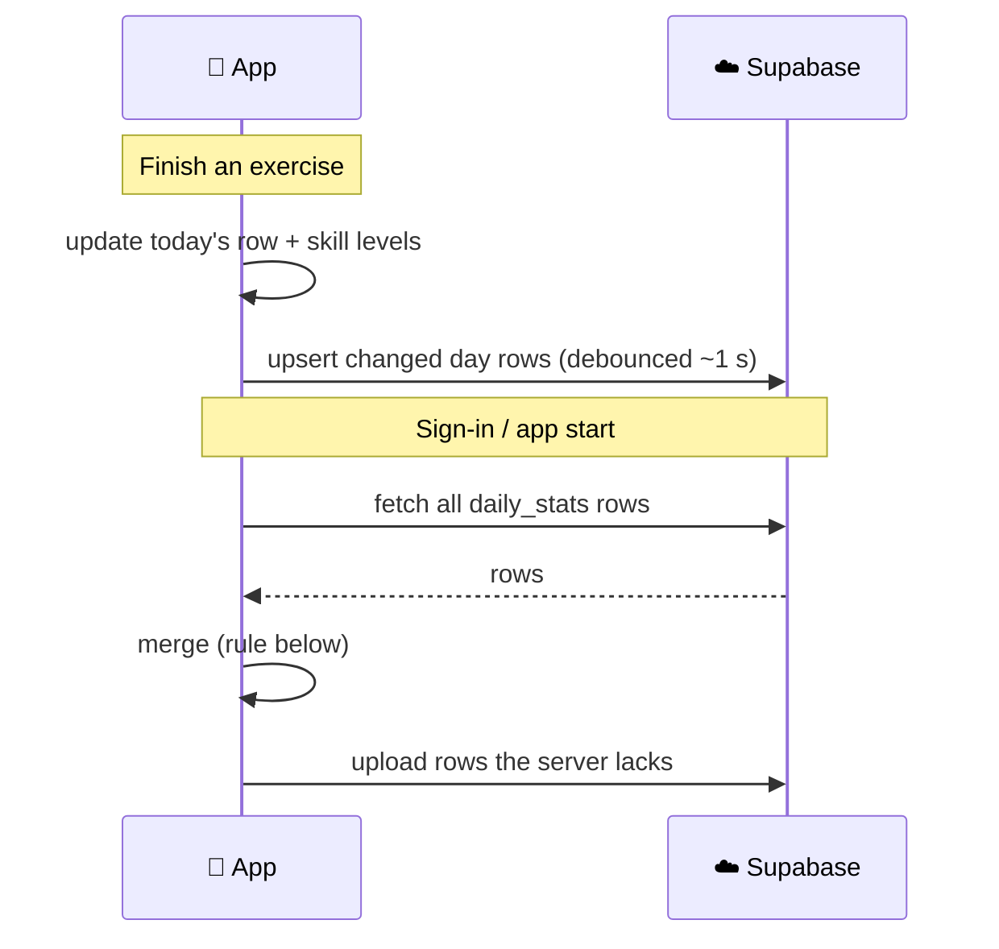

# How the Progress numbers work

A plain-language guide to every number on the **Progress** tab: what it means, how it's calculated, and where it's stored.

> **In one sentence:** every finished exercise does three things. It adds to today's counters, it nudges the long-term level of each skill that exercise trains, and it saves both to a small row for that day. Everything on the Progress tab is read from those daily rows.

---

## 1. The screen at a glance

```
┌───────────────────────────────────────────────┐
│  Progress 🎤                                  │
│                                               │
│  ┌──────────┐ ┌──────────┐ ┌──────────┐       │
│  │ ♫  37%   │ │ ☆  212   │ │ ┃┃ 53%   │       │  ← skill levels and all-time counts
│  │ Pitch    │ │ Perfect  │ │ Rhythm   │       │    (tap any tile → its history)
│  │ accuracy │ │ notes    │ │          │       │
│  └──────────┘ └──────────┘ └──────────┘       │
│  ┌──────────┐ ┌──────────┐ ┌──────────┐       │
│  │ ⌐  13%   │ │ ▦  10d   │ │ ◷  1 h   │       │
│  │ Pitch    │ │ Days     │ │ Practice │       │
│  │ stability│ │ practiced│ │ time     │       │
│  └──────────┘ └──────────┘ └──────────┘       │
│                                               │
│  Track your consistency     ← month calendar  │
│  Mastery changes in last 7 days  ← from → to  │
│  Last 7 days summary        ← plain sentences │
└───────────────────────────────────────────────┘
```

The six tiles come in two kinds:

| Kind | Tiles | Question it answers |
|---|---|---|
| **Skill level** (0–100) | Pitch accuracy · Rhythm · Pitch stability | *"How good am I at this right now?"* |
| **All-time count** | Perfect notes · Days practiced · Practice time | *"How much have I done since I started?"* |

---

## 2. Where the numbers come from



| Store | Lives in | Holds | Kept for |
|---|---|---|---|
| `progressStore.sessions` | Device | Every attempt in full detail | Newest **500** only |
| `progressStore.days` | Device + Supabase | One row of counters per day | **Forever** |
| `learningStore.skills` | Device + Supabase | Current level of each of the 13 skills | Always current |
| `learningStore.masteryHistory` | Device + Supabase | Each day's closing skill levels | **Forever** |

**Why daily rows?**
- **The session list is capped at 500.** "All time" can't be counted from it, because after a few months the oldest sessions are gone. A day row is about 80 bytes, so years of history cost almost nothing.
- **Nothing waits for the week to end.** History is saved day by day as you practise, so it doesn't depend on the app being open on Sunday night.

---

## 3. The skill level (mastery)

The three skill tiles, the mastery rows and the history lines all show **one number per skill: its mastery**. The same number appears on the Home tab under "Accuracy".

### 3.1 The idea

Mastery is a **slow running average** of how you do on every exercise that trains the skill.

- **It starts at 30** for everyone, a neutral starting guess. Until you've trained a skill, the tile shows **"—"** instead of 30.
- **Early on it moves fast.** With little evidence, each session counts a lot.
- **Later it moves slowly.** With lots of evidence, one bad day barely changes it, while steady practice does.

### 3.2 The formula

After each session, for each skill the exercise trains:

```
new level = old level + rate × (session result − old level)
```

The **rate** is how big a step the level takes toward the session's result:

```
rate = weight × (0.30 − 0.22 × confidence)
```

| Part | Meaning |
|---|---|
| `session result` | The exercise's score for that skill, 0–100 (overall score, stability or rhythm, depending on the skill) |
| `weight` | How strongly this exercise trains the skill, 0–1 (see 3.4) |
| `confidence` | How much evidence there is, 0–1. Rises with each session and fades slowly over a break (evidence halves every 30 days) |

So the rate drops from **0.30** for a brand-new skill to about **0.08** once a skill is well practised.

### 3.3 Worked example

Five "Echo the note" sessions, which train pitch accuracy at full weight, one a day:

| # | Session score | Confidence | Rate | Pitch accuracy |
|---|---|---|---|---|
| — | — | 0 | — | **30** (start) |
| 1 | 80 | 0.15 | 0.27 | **43** |
| 2 | 80 | 0.28 | 0.24 | **52** |
| 3 | 80 | 0.39 | 0.21 | **58** |
| 4 | 40 😕 | 0.48 | 0.20 | **55** ← a bad day costs only 3 points |
| 5 | 80 | 0.55 | 0.18 | **59** |

```
Pitch accuracy
 60 ┤                             ●───────●
 55 ┤                    ●───────╯   ╲───╯       ← day 4 dips a little
 50 ┤            ●──────╯
 45 ┤    ●──────╯
 40 ┤   ╱
 35 ┤  ╱
 30 ┼─●
    └──┬──────┬──────┬──────┬──────┬──────┬──
     start   d1     d2     d3     d4     d5
```

### 3.4 Which exercises feed which tile

| Tile | Fed by | Weight | Uses the session's… |
|---|---|---|---|
| **Pitch accuracy** | Echo the note | 1.0 | Score |
| | Melody practice (staff) | 0.8 | Score |
| | Pitch memory, Melody echo, Finish the melody, Sing the interval, Echo the interval | 0.3 | Score |
| **Rhythm** (rhythm accuracy) | Melody practice (staff) | 1.0 | Rhythm |
| **Pitch stability** | Melody practice (staff) | 1.0 | Stability |

Rhythm and stability come **only from melody practice**, which actually measures them. Ear drills don't measure rhythm or steadiness, so they're left out instead of polluting these numbers.

The full table for all 13 skills is in `src/features/learning/lib/skillMap.ts`.

---

## 4. The all-time counts

| Tile | Calculation | Example display |
|---|---|---|
| **Perfect notes** | Sum of every graded note sung within the "perfect" tolerance (`PERFECT_CENTS`) | `212` |
| **Days practiced** | Number of local calendar days with at least one finished exercise | `10d` |
| **Practice time** | Total time in exercises, listening included; one exercise counts for at most 10 min | see below |

**Practice time format** (the tile is narrow):

| Total | Shown as |
|---|---|
| under 60 min | `16 min` |
| 1–10 hours | `2.5 h` (one decimal) |
| 10+ hours | `37 h` (whole hours) |

**Notes:**
- **Days practiced only grows.** Missing a day never takes it down, unlike a streak.
- **Practice time takes the larger of two totals:** the running total and the sum of the day rows. Each can hold time the other missed (older synced sessions, or another device). Home and Progress both use this rule (`allTimePracticeSeconds`).

---

## 5. "Last 7 days"

Both lower cards cover a **rolling window: today plus the 6 days before it**.

```
           ┌──────────── last 7 days ─────────────┐
 ... ─ Fri │ Sat ─ Sun ─ Mon ─ Tue ─ Wed ─ Thu ─ Fri │
        ▲  └──────────────────────────────────────┘ ▲
        │                                            │
  "from" = level at the                         "to" = level
  close of this day                             right now
```

**Why rolling and not Monday to Sunday?**
- A calendar week is empty every Monday morning.
- A rolling week always shows the last seven days of real practice.

### 5.1 Mastery changes card

For every skill:

```
from = level at the close of the day before the window   (30 if the skill wasn't trained yet)
to   = level now
```

- **Which rows appear:** only skills whose rounded value changed.
- **Order:** biggest gain first.
- **Arrow:** lime ↗ for a gain, orange ↘ for a drop.
- **Tapping a row** opens that skill's history.

### 5.2 Summary card

Up to four sentences, built from the same window:

| Line | Shown when | Example |
|---|---|---|
| Practice | Always | *You practiced on 4 days in the last 7 days (57 sessions).* |
| Biggest jump | Some skill went up | *Interval singing made the biggest jump: 30% → 36%.* |
| Weekly focus | A focus is set | *Your focus (Pitch accuracy) moved 30% → 53% — the focused work paid off.* |
| Weakest area | At least one skill trained | *Pitch stability is currently your weakest area (13/100).* |

---

## 6. History screens (tap any tile)

Every screen has range tabs (**4 wk · 3 mo · 6 mo · 1 yr**), a chart, and a "What this number means" note.

### Skill tiles → line chart

```
 100 ┤
  75 ┤ ─ ─ ─ ─ ─ ─ ─ ─ ─ ─ ─ ─ ─ ─ ─ ─
  50 ┤ ─ ─ ─ ─ ─ ─ ─ ─ ─ ─ ●───●╮─ ─ ─
  25 ┤ ─ ─ ─ ─ ─ ─ ●──────╯     ╰──●     ← one point per practised day
   0 ┼──────────────────────────────────
     26 Jul                       Today
```

- **Each point** is the level at the close of a practised day. The line holds flat between practised days, because mastery only changes when you practise.
- **The headline** shows the level now, plus the change across the range: `+7 in this period`.
- **A skill first trained inside the range** starts its line on that day, at 30.

### Count tiles → bar chart

```
 34 min ┤                         ██
        ┤                         ██  ▓▓
        ┤                         ██  ▓▓
        ┤ ▁▁ ▁▁ ▁▁ ▁▁ ▁▁ ▁▁ ▁▁ ▃▃ ██  ▓▓   ← newest bar is solid
        └──────────────────────────────
         26 Jul               Today
              Each bar is 1 week
```

| Range | Bars | Each bar |
|---|---|---|
| 4 wk | 4 | 1 week |
| 3 mo | 13 | 1 week |
| 6 mo | 13 | 2 weeks |
| 1 yr | 13 | 4 weeks |

- **Bars end today.** The newest bar is exactly the "last 7 days" used everywhere else.
- **The headline** shows the all-time total, plus the total inside the range: `212 in this period`.

---

## 7. Storage and sync

### 7.1 The `daily_stats` table (Supabase)

One row per user per **local** calendar day (a session at 23:30 counts for that evening, not the next UTC day).

| Column | Written by | Meaning |
|---|---|---|
| `user_id`, `day` | both | Primary key |
| `sessions` | progress store | Exercises finished that day |
| `practice_sec` | progress store | Seconds practised |
| `perfect_notes` | progress store | Notes sung perfectly |
| `graded_notes` | progress store | All graded notes |
| `mastery` | learning store | `{ "pitch-accuracy": 52, … }`, levels at the close of the day |

- **Two writers, no overwrites:** each store upserts **only its own columns**, so neither can wipe the other's data.
- **Access:** row-level security means users see only their own rows.
- **Account deletion:** the rows are deleted along with the account.

### 7.2 Sync flow



**Merge rule:**
- **Day counters:** keep the copy that counted **more sessions**. A day's counters only ever grow, so the bigger copy is the more complete one.
- **Closing levels:** for days the device already has, the device's copy wins.

### 7.3 Upgrading users

Users updating from an older version get their history filled in automatically on first launch:
- **Day counters** are rebuilt from the sessions still on the device.
- **Closing levels** are rebuilt from the session notes. Each note recorded how much the session changed each skill, so the app walks back from today's levels one day at a time.

---

## 8. FAQ

**Why does a skill show "—" instead of 30%?**
30 is only the starting guess before any practice. Showing it would suggest the singer had been measured.

**Why did my level barely move after a great session?**
That's by design. The more you've practised a skill, the more evidence backs its level, so single sessions move it less. Many good sessions in a row move it a lot.

**Why might "Pitch accuracy" differ from a single exercise's score?**
The exercise score is one attempt. The tile is the long-term average across every exercise that trains pitch accuracy.

**Does a long break lower my level?**
No. The level stays where it was. Only the confidence behind it fades, so the first sessions after a break move it a bit faster again.

---

## Code map

| Concern | File |
|---|---|
| Day counters, merging, totals | `src/features/progress/lib/history.ts` |
| Chart ranges and bars | `src/features/progress/lib/series.ts` |
| Mastery formula | `src/features/learning/lib/mastery.ts` |
| Exercise → skill weights | `src/features/learning/lib/skillMap.ts` |
| Daily closing levels, backfill, "as of" | `src/features/learning/lib/masteryHistory.ts` |
| Summary sentences | `src/features/learning/lib/weekly.ts` |
| Progress tab numbers | `src/screens/progress/useProgressOverview.ts` |
| History screen | `src/screens/progress/history/` |
| Sync | `src/features/auth/model/syncService.ts` |
| Table | `supabase/migrations/00010_daily_stats.sql` |
